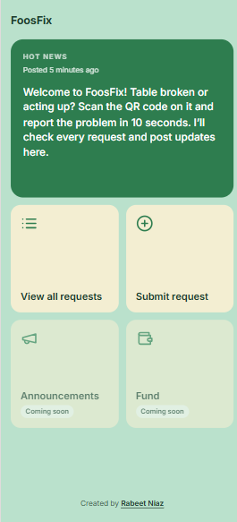
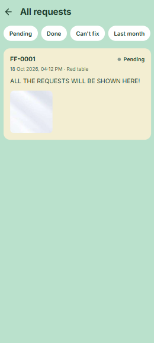

# FoosFix

A small web app for reporting and tracking broken campus foosball tables. A student scans a QR code on the table, reports the problem in about ten seconds, and everyone can follow the status. No accounts are needed.

**Live site:** https://foosfix.vercel.app
**Built by:** [Rabeet Niaz](https://www.linkedin.com/in/rabeet-niaz-8b659039a/)




## Why I built it

The foosball tables on campus broke down every week or so and stayed broken, because nobody was responsible for servicing them. A repair costs less than a dollar. I built FoosFix so that problems reach one person quickly, and so students can see that a report was seen and handled.

## Features

**Students (no login)**
- Hot news block on the home screen for the latest fixes and updates
- View all requests, with filters for Pending, Done, Can't fix, and Last month, plus "Load more" paging
- Submit a request: choose a table, describe the issue (up to 500 characters), and attach up to 3 photos
- Optional roll number, checked against the university format and never shown publicly
- Photos are compressed to about 1 MB in the browser before upload
- Each table has a QR code that opens the form with that table already selected

**Admin (hidden login)**
- Change a request's status: Pending, Done, or Can't fix
- Add one or more comments to a request, shown to the public under the request
- Archive a request instead of deleting it (hidden from the public, kept in the database), and restore it later
- Post hot news and see live counts per status

## Tech stack

| Part | Technology |
|---|---|
| Frontend | React (Vite), React Router, browser-image-compression |
| Backend | Node.js, Express, Mongoose |
| Database | MongoDB Atlas |
| Photos | Cloudinary |
| Auth | JWT with bcrypt-hashed admin password |
| Hosting | Vercel (frontend), Render (backend) |

## Design decisions

- **No student accounts.** The goal was to make reporting as fast as possible. Spam is limited with per-IP rate limits instead (5 submissions per 10 minutes, 10 login attempts per 15 minutes).
- **Archive instead of delete.** Removing a request from public view keeps it in the database, so statistics stay accurate.
- **Roll numbers stay private.** The field is excluded from queries by default and is only added back in admin routes, so it can't leak through the public API.
- **Validation on both sides.** The browser checks photos and fields for a good experience, and the server repeats every check, including photo size and type, because a browser check can be bypassed.
- **Validate before uploading.** Text fields are checked before any photo is sent to Cloudinary, so a rejected request never leaves orphaned images.
- **Readable request IDs.** IDs like `FF-0001` come from an atomic counter, so two simultaneous submissions never get the same number.
- **Secrets stay out of the code.** All keys and passwords are environment variables, and CORS only allows the frontend's address.

## API overview

**Public**
- `GET /api/tables`
- `GET /api/hotnews`
- `GET /api/requests?status=&lastMonth=&page=`
- `POST /api/requests` (multipart form with photos)

**Admin (Bearer token)**
- `POST /api/admin/login`
- `GET /api/admin/requests?status=&archived=&page=`
- `GET /api/admin/counts`
- `PATCH /api/admin/requests/:id/status`
- `POST /api/admin/requests/:id/comments`
- `PATCH /api/admin/requests/:id/archive`
- `POST /api/admin/hotnews`

## Project structure

```
foosfix/
  client/   React app (pages, components, API helper, styles)
  server/   Express API (models, routes, middleware, config)
```

## Run it locally

You need Node 20 or newer, a MongoDB Atlas database, and a Cloudinary account.

1. Clone the repo.
2. Backend: in `server/`, run `npm install` and create a `.env` file with:
```
   PORT=5000
   MONGO_URI=
   JWT_SECRET=
   CLIENT_ORIGIN=http://localhost:5173
   CLOUDINARY_CLOUD_NAME=
   CLOUDINARY_API_KEY=
   CLOUDINARY_API_SECRET=
   ADMIN_USERNAME=
   ADMIN_PASSWORD_HASH=
```
   Create the password hash with:
   `node -e "console.log(require('bcryptjs').hashSync('your-password', 10))"`
3. Add the tables with `node seed.js`, then start the API with `npm run dev`.
4. Frontend: in `client/`, create a `.env` file with `VITE_API_URL=http://localhost:5000`, then run `npm install` and `npm run dev`.

## Results

*(Fill this in with real numbers after a few weeks of use.)*
- Requests received: [number]
- Requests marked Done: [number]
- Average time from report to Done: [number] hours
- Unique visitors: [number]

## Known limits and next steps

- The free backend host goes to sleep when idle. A monitor pings it regularly to keep it awake.
- Planned: an Announcements page with full history, and a Fund page.